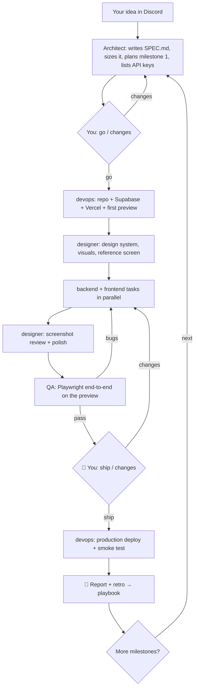

# Dispatch

**Message an idea from your phone. A team of AI agents plans it, designs it, builds it, tests it, deploys it, and
reports back with the live URL.**

Dispatch is a self-hosted harness around the [Claude Agent SDK](https://docs.claude.com). You talk to it in a
Discord channel; it runs an architect, designer, backend, frontend, devops, QA, researcher and debugger agent on
your own machine or server, using your own GitHub, Vercel and Supabase accounts.

```
You (Discord, from anywhere)            Dispatch (your laptop / VPS, in Docker)
───────────────────────────            ──────────────────────────────────────
"Build a waitlist app with an      →   architect writes the spec + plan
 admin page and CSV export"            designer builds a design system
                                       backend · frontend · devops build in parallel
"go"                               →   designer reviews screenshots, QA tests the preview
                                       🚦 "Ready for production" + screenshots
"ship"                             →   release to production, smoke test
                                   ←   🎉 LIVE: app URL, repo, cost, what was fixed
```

From the first real runs: a small waitlist app (landing page, signups, admin login, CSV export) went live in
**23 minutes for $2.87** in API costs. The first milestone of a course-creation platform (auth, landing page,
record/paste → AI-generated course → editor → public storefront) passed QA for **$6.75**.

> Status: early and moving fast. It works well for small-to-medium web apps on the default stack. Expect rough
> edges on large products; that's what the milestones, budgets and approval steps are for.

---

## Contents

- [How it works](#how-it-works)
- [Quick start](#quick-start)
- [Using it](#using-it)
- [Configuration](#configuration)
- [Costs and limits](#costs-and-limits)
- [Code layout](#code-layout)
- [Development](#development)

---

## How it works

### The flow



### The team

| Agent | What it does |
|---|---|
| **Architect** | Turns your idea into a spec (`SPEC.md` in the repo), splits big products into milestones, plans tasks with dependencies, re-plans when the team is stuck, handles your change requests. |
| **Designer** | Studies strong references online, picks a direction specific to the product (palette, type, layout, motion), builds tokens and base components, sources licensed visuals and records product demo videos, then screenshots every key page on mobile and desktop and fixes what looks off. Deliberately avoids the generic "AI-generated" look. |
| **Backend** | Schema + migrations, row-level security, auth, APIs, integrations (behind real/mock providers). |
| **Frontend** | Pages and flows, following the design system exactly; empty, loading and error states; mobile-first. |
| **DevOps** | GitHub repo, Supabase project, Vercel project and env vars, preview deploys, production release (only after your approval). |
| **QA** | Tests the deployed preview like a user with Playwright; files every defect as a task for the right agent. |
| **Researcher** | When a task is stuck, searches the exact error, official docs, GitHub issues and changelogs, and returns a cited fix. |
| **Debugger** | Takes over a task that failed repeatedly, with the full history, peer advice and research. |

All agents share one repo and a **blackboard** (contracts, notes, resources such as URLs) and can ask each other
questions directly (`ask_peer`).

### When an agent gets stuck

Every task climbs an escalation ladder until it's solved, and you're only asked at the very end:

| Step | What happens |
|---|---|
| 1 | The assigned agent works the task (and can ask any teammate mid-task) |
| 2 | Retry with the failure summary and any matching fixes from the research library |
| 3 | **Peer consult + web research** in parallel: two relevant specialists read the repo; a researcher searches the web and cites sources |
| 4 | **Debugger takes over** with everything learned so far |
| 5 | **Architect re-plans**: rewrites the task or splits it into smaller ones |
| 6 | **You** get one message with the problem and history; reply with guidance, `skip` or `fail` |

### It gets better with every build

- **Research library** (`data/research.jsonl`): every solved problem is saved with its fix and sources. Agents
  check it before searching the web, so a problem solved once stays solved.
- **Playbook** (`data/playbook.md`): after each milestone a retro turns what went wrong into short, general lessons
  that every agent reads on every future build. Add your own with `lesson: ...` in any thread.

### Keys never block the build

The architect lists every external API key the product needs. Missing keys never stop work: each service sits
behind a real and a mock implementation, chosen by whether the env var is set. Send a key later (in
`config.yaml` or as `NAME=value` in the thread) and a task is queued to switch that service to the real provider.

---

## Quick start

### 1. Accounts (one-time, about 20 minutes)

| Service | What to create | Goes in `config.yaml` |
|---|---|---|
| **Anthropic** | console.anthropic.com → API key, add credit, set a monthly limit | `anthropic.api_key` |
| **Discord** | Developer Portal → New Application → Bot → Reset Token. Turn on **Message Content Intent**. OAuth2 URL Generator: scopes `bot` + `applications.commands`; permissions Send Messages, Create Public Threads, Send Messages in Threads, Read Message History, Add Reactions, Manage Messages. Invite it to your server, create a `#dispatch` channel. With Developer Mode on, copy the channel ID and your user ID. | `discord.bot_token`, `discord.channel_id`, `discord.owner_user_id` |
| **GitHub** | Settings → Developer settings → Tokens (classic): `repo`, `workflow`, `read:org` (not `delete_repo`) | `github.token`, `github.owner` |
| **Vercel** | vercel.com/account/tokens | `vercel.token` (+ `team_id` if using a team) |
| **Supabase** | Account → Access Tokens; Organization settings → slug | `supabase.access_token`, `supabase.org_id` |
| **Git author** | The email you log into Vercel with (Vercel only deploys commits from account members) | `git.author_email` |

### 2. Run it

You need Docker and a machine that stays on: a laptop that doesn't sleep, or any Linux VPS with 4 GB+ RAM.

```bash
git clone https://github.com/<you>/dispatch && cd dispatch
cp config.example.yaml config.yaml      # fill in the values above
docker compose build
docker compose run --rm dispatch python -m harness --config /app/host/config.yaml --check
docker compose up -d
```

On a Mac, `./setup-mac.sh` does all of this and tells you how to keep the machine awake.

`--check` is a full **preflight**: it validates every value in `config.yaml`, logs into each service, and checks the
Discord bot's intent and permissions, the GitHub token scopes, your Supabase project quota, Anthropic credit, and
local CPU, RAM and disk. The bot refuses to start until everything passes, so builds don't stall halfway on a bad key.

When it's up, the bot posts **🟢 Dispatch online** in your channel.

---

## Using it

### Start a project

Post the idea as a normal message in the channel. Write it the way you'd brief a person: who it's for, what it
does, anything you care about. That's all it needs.

> Build a habit tracker for remote teams: members check in daily, managers see streaks and a weekly digest.
> Mobile-first, magic-link login, free for up to 5 users then $4/user/month.

Optional extras:
- Attach a `.md` or `.txt` file with notes or a spec. It's treated as binding product decisions; any process
  instructions in it are ignored.
- Attach screenshots of apps you like. The designer uses them as mood references.

A thread opens for the project. Everything about it happens there.

### What you reply with (in the thread)

| You send | Effect |
|---|---|
| `go` | Approve the plan |
| any text | A question, an instruction or a change request; the architect turns it into tasks |
| `NAME=value` lines | Save API keys (the message is deleted; keys apply to the next agent run) |
| `ship` | Approve the production release at the 🚦 step |
| `next` | Start the next milestone |
| `status?` / `eta?` | Progress bar, % done, ETA, and what each agent is doing right now |
| `lesson: ...` | Teach the team something for all future builds |
| screenshots | Design references for the designer |
| `#3 answer` | Answer a specific question when several are open |

### Slash commands

| Command | |
|---|---|
| `/build idea:` | Start a project (same as posting in the channel) |
| `/status` | Full progress and task list |
| `/projects` | All projects and their state |
| `/budget usd:` | Set the project's spending cap |
| `/pause` · `/resume` | Pause or resume a project |
| `/next` | Next milestone |
| `/cancel` | Stop a project permanently |

### Messages you'll get

- 📋 the plan · 🔑 API keys it needs (mocks run until you send them)
- 🔧 milestones · ⏱️ progress every 20 minutes (silent while it's waiting on you)
- 🤝 / 🔎 / 🐛 when something is stuck and the team is working it out
- ❓ questions only a human can answer · ⚠️ approval for risky commands
- 🚦 **Ready for production**, with the preview link, QA results and mobile/desktop screenshots
- 🎉 **LIVE** with the URL, repo, cost, blockers solved and anything left on mocks

### Levels of control

| | Plan approval | Between milestones | Before production |
|---|---|---|---|
| **Default** | you reply `go` | you reply `next` | you reply `ship` |
| `autonomy: full` | automatic | automatic | automatic after QA |

With full autonomy you only hear about progress, blockers the whole team couldn't solve, and the final report.
The budget is the hard stop, so set one.

---

## Configuration

Everything lives in one file, `config.yaml` (see `config.example.yaml` for every option). Edits to `extra_env` apply
without a restart. The settings you'll actually touch:

| Setting | Default | |
|---|---|---|
| `harness.autonomy` | `""` | `full` = no approval stops |
| `harness.project_budget_usd` | 50 | Hard cap per project; change live with `/budget` |
| `harness.max_parallel_agents` | `auto` | Sized from the machine (about 1 agent per 2.5 GB RAM, capped by CPUs, max 8); never starts one below 2 GB free |
| `harness.designer` | true | Designer agent + screenshot review |
| `harness.web_research` | true | Researcher agent for stuck tasks |
| `harness.browser` | true | Headless browser tool (Playwright MCP) |
| `harness.release_approval` | true | 🚦 step before production |
| `harness.models` | sonnet; opus for architect + debugger | Any Claude model alias or ID |
| `extra_env` | | Product keys (Stripe, Resend, ...), plus optional `UNSPLASH_ACCESS_KEY` / `PEXELS_API_KEY` for photos |

---

## Costs and limits

- **API cost** is the main cost: about $3 for a small app, roughly $5–25 per milestone of a bigger product. Every
  report shows the exact cost; budgets are enforced per project and per agent run.
- **Hosting**: nothing extra beyond your machine. Generated apps run on your Vercel and Supabase accounts (free
  tiers work for testing).
- **Supabase free plan allows 2 active projects.** Each build creates one, so pause old ones (preflight blocks startup until there is room).
- **Default stack**: Next.js + Tailwind + Supabase + Vercel. Other stacks work if your idea or spec names them, but
  are less battle-tested.
- **One shared working copy**: parallel agents edit the same repo. Conflicts are rare because tasks are split by
  area, but it's the main reason parallelism is capped.
- **Your machine must stay on.** If it sleeps, work pauses and resumes automatically when it wakes.

See [SECURITY.md](SECURITY.md) for the security model and recommended credential scopes.

---

## Code layout

```
harness/
  __main__.py      entry point: Discord mode, --cli local mode, --check preflight
  orchestrator.py  project lifecycle, milestones, scheduler, escalation ladder, release gate, retro
  agents.py        agent roles (prompts) and the Claude Agent SDK runner (tools, browser, budgets)
  tools.py         tools agents call: blackboard, ask_peer, ask_owner, create_task, Supabase API, research
  research.py      secret scrubbing + research library
  capacity.py      container-aware parallelism (cgroup RAM/CPU)
  preflight.py     config + account validation
  discord_bot.py   threads, slash commands, keys, screenshots, design references
  notify.py        channel-agnostic messaging (subclass it for Slack, Telegram, ...)
  config.py, db.py config loading, SQLite state (resumes after restarts)
tests/             simulated end-to-end tests with fake agents (no keys or network)
examples/          an example product spec
```

Local mode without Discord: `python -m harness --cli "your idea"` (questions and answers happen in the terminal).

## Development

```bash
pip install -r requirements.txt
./tests/run_all.sh
```

The tests drive the real orchestrator, database and tools with fake agents, covering escalation, milestones, key
handling, release approval, the designer flow, cancellation, progress/ETA, autonomy, auto-capacity, the production
deploy gate, restart repair, preflight, the research library and git identity. See [CONTRIBUTING.md](CONTRIBUTING.md).

**Roadmap:** per-task git worktrees, Slack/Telegram notifiers, a web dashboard, Neon as a database option,
multi-user hosted mode.

## License

[MIT](LICENSE)
